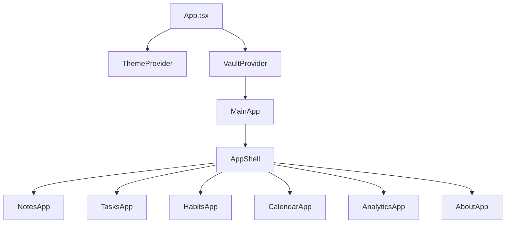
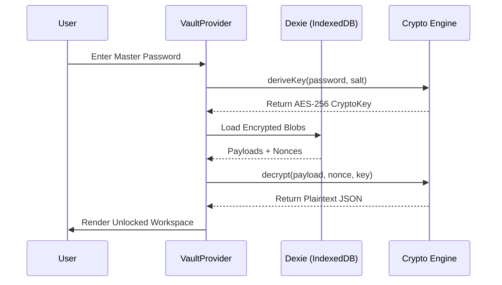

# 🏗️ Code Visualization & Analysis

## Component Hierarchy Map

The application follows a container-based modular structure.

## Data Life Cycle (Sequence Diagram)

## Module Responsibilities

| Module | Responsibility |
| :--- | :--- |
| `useVault` | Manages Master Password, Key Derivation, and Vault Metadata. |
| `useItems` | Core CRUD operations. Handles encryption *before* writing to DB. |
| `AppShell` | Responsive layout wrapper with Sidebar/BottomNav logic. |
| `ContainerItem` | Generic UI wrapper for all vault items (Notes/Tasks/Habits). |
| `crypto.ts` | Stateless wrapper for the Web Crypto API. |
| `db.ts` | Dexie.js schema definition and database initialization. |

## Storage Standard Note (2026-10-18)

The diagram and module table above describe the current implementation. **Storage standard (decided 2026-10-18):** This app is migrating from IndexedDB (Dexie.js) to SQLite with SQLCipher — the whole database file encrypted with AES-256, keys derived from your master password and never leaving your device. Until the migration lands, the app runs on Dexie/IndexedDB with all content AES-256-GCM encrypted before it reaches the storage layer. Zero-knowledge throughout: we never hold your keys or your data.
